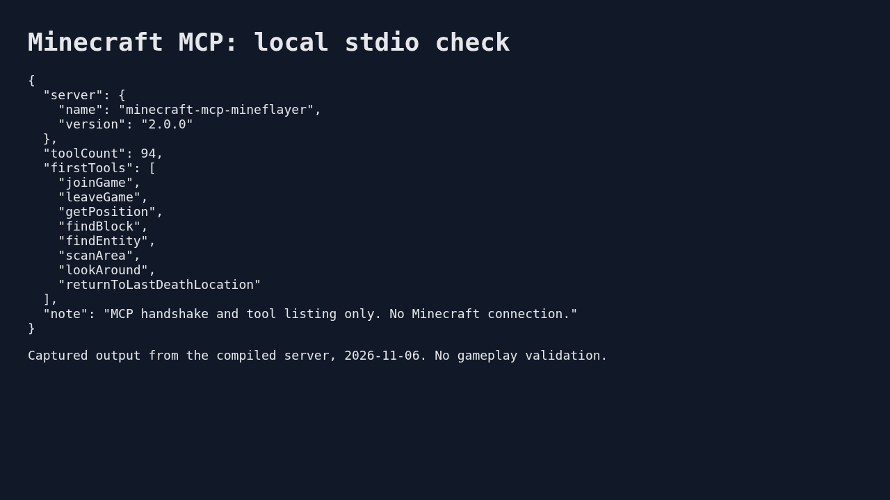

# minecraft-mcp-mineflayer

[](https://github.com/XanderXML-Bit/mineflayer-mcp/actions/workflows/ci.yml)

A Model Context Protocol (MCP) server that lets AI clients control Mineflayer bots on Minecraft Java Edition servers.

Built by [Xander M. Lopez](https://xandermlopez.com) / [Zendren](https://zendren.net).

## Check availability

This is the public source. There is no hosted app and no npm release; run it from a clone as shown below.
Use the [repository documentation](https://github.com/XanderXML-Bit/mineflayer-mcp) as the project reference.
The package is marked `private: true` to prevent accidental npm publication.

The automated suite uses mocked bots. Passing tests do not establish live-server compatibility or successful gameplay.

## Install from source

You need Node.js 22.23.3 and npm 10.
The stack uses TypeScript, Mineflayer, `mineflayer-pathfinder`, the MCP SDK, Zod, YAML, and Vitest.

1. Clone the repository.

   ```sh
   git clone https://github.com/XanderXML-Bit/mineflayer-mcp.git
   cd mineflayer-mcp
   ```

2. Select the pinned Node.js version with your version manager.

   ```sh
   nvm install
   nvm use
   ```

3. Install locked dependencies. The `prepare` script builds the source during installation.

   ```sh
   npm ci
   ```

4. Build the source explicitly.

   ```sh
   npm run build
   ```

## Connect an MCP client

Add this entry to your client's MCP configuration. Replace the absolute path with your checkout path.

```json
{
  "mcpServers": {
    "minecraft": {
      "command": "node",
      "args": ["/absolute/path/to/mineflayer-mcp/dist/index.js"]
    }
  }
}
```

You can also start the stdio server with `npm start`.
The packaged `bin/cli.js` launcher is not release-ready. Use the compiled entry point above.

Configure defaults in `config/default.config.yaml` or `config.yaml` in your working directory.
Environment overrides include `MCP_BOT_HOST`, `MCP_BOT_PORT`, and `MCP_LOG_LEVEL`.
Only connect bots to servers where you have permission.
Keep authenticated server access and credentials outside the repository.
Do not disable a public server's authentication to connect a bot.

## Use the tools

Ask your MCP client to list tools before calling them.
The source includes connection, movement, combat, inventory, crafting, storage, communication, and memory tools.
It also includes skill storage, goal planning, and reflection services.
These services store and process tool sequences. They do not provide an independent language model.

Example tool arguments for an authorized local server:

```json
{"name":"joinGame","arguments":{"username":"Bot","host":"localhost","port":25565}}
```

See the [skill library documentation](docs/SKILL-LIBRARY.md) for stored sequences.
Check your server's protocol version against the locked Mineflayer dependency before connecting.
Live gameplay across Minecraft versions is not part of the offline CI checks.

## Inspect a real protocol check



This image renders the actual local MCP handshake output, not a gameplay screenshot.
The server reports version `2.0.0`, while `package.json` declares `1.0.0`. Reconcile that difference before release.
Run `node scripts/smoke.mjs` after building to reproduce the check.

## Run the checks

```sh
npm run lint
npm run typecheck
npm run build
npm test
```

The type check includes a regression contract for whisper events and `recentChat` responses.
The workflow runs installation, lint, type checks, build, and tests on pushes and pull requests.
Two existing non-null assertion warnings remain in `src/utils/mining-helpers.ts`.

For focused tests or coverage:

```sh
npm test -- tests/unit/tools/base-tool.test.ts
npm run test:watch
npm run test:coverage
```

## Read the source

- `src/tools/` defines MCP tools and foreground/background execution.
- `src/services/` implements bot behavior, event buffering, memory, and planning.
- `src/types/` defines bot events and tool responses.
- `src/config/` loads defaults, YAML configuration, and environment overrides.
- `tests/` contains offline tests and the compile-time chat contract.
- `dist/` is created by `npm run build` and holds the generated JavaScript and declarations.

## License

All rights reserved. See [LICENSE](LICENSE).
No open-source license is granted. Third-party dependencies retain their own licenses.

## Read upstream references

- [Mineflayer](https://github.com/PrismarineJS/mineflayer)
- [MCP SDK](https://github.com/modelcontextprotocol/typescript-sdk)
- [Voyager research](https://voyager.minedojo.org/)
- [MindCraft](https://github.com/mindcraft-bots/mindcraft)
